# Basic Ingress Controller

This use case shows how to publish two sample applications using:

- URI-based routing
- TLS offload

## Architecture and Traffic Flow

The following diagram illustrates the architecture and traffic flow for this lab:



Get NGINX Ingress Controller Node IP, HTTP and HTTPS NodePorts
```code
export NIC_IP=`kubectl get pod -l app.kubernetes.io/instance=nic -n nginx-ingress -o json|jq '.items[0].status.hostIP' -r`
export HTTP_PORT=`kubectl get svc nic-nginx-ingress-controller -n nginx-ingress -o jsonpath='{.spec.ports[0].nodePort}'`
export HTTPS_PORT=`kubectl get svc nic-nginx-ingress-controller -n nginx-ingress -o jsonpath='{.spec.ports[1].nodePort}'`
```

Check NGINX Ingress Controller IP address, HTTP and HTTPS ports
```code
echo -e "NIC address: $NIC_IP\nHTTP port  : $HTTP_PORT\nHTTPS port : $HTTPS_PORT"
```

`cd` into the lab directory
```code
cd ~/NGINX-Ingress-Controller-Lab/labs/1.basic-ingress
```

Deploy two sample web applications
```code
kubectl apply -f 0.cafe.yaml
```

Verify that all pods are in the `Running` state

```code
kubectl get all
```

Output should be similar to

```
NAME                          READY   STATUS    RESTARTS   AGE
pod/coffee-56b44d4c55-4v6jp   1/1     Running   0          32s
pod/coffee-56b44d4c55-gdgdw   1/1     Running   0          32s
pod/tea-596697966f-cc4zj      1/1     Running   0          28m
pod/tea-596697966f-hbt7x      1/1     Running   0          28m
pod/tea-596697966f-mhd9k      1/1     Running   0          28m

NAME                 TYPE        CLUSTER-IP      EXTERNAL-IP   PORT(S)   AGE
service/coffee-svc   ClusterIP   172.20.10.229   <none>        80/TCP    28m
service/kubernetes   ClusterIP   172.20.0.1      <none>        443/TCP   2d23h
service/tea-svc      ClusterIP   172.20.169.88   <none>        80/TCP    28m

NAME                     READY   UP-TO-DATE   AVAILABLE   AGE
deployment.apps/coffee   2/2     2            2           32s
deployment.apps/tea      3/3     3            3           28m

NAME                                DESIRED   CURRENT   READY   AGE
replicaset.apps/coffee-56b44d4c55   2         2         2       32s
replicaset.apps/tea-596697966f      3         3         3       28m
```

Create TLS certificate and key to be used for TLS offload
```code
kubectl apply -f 1.cafe-secret.yaml
```

Publish `coffee` and `tea` through NGINX Ingress Controller using the `Ingress` resource
```code
kubectl apply -f 2.cafe-ingress.yaml
```

Check the newly created `Ingress` resource
```code
kubectl get ingress
```

Output should be similar to
```code
NAME           CLASS   HOSTS              ADDRESS   PORTS     AGE
cafe-ingress   nginx   cafe.example.com             80, 443   13s
```

[Test](#test-application-access) application access

Delete the `Ingress` resource

```code
kubectl delete -f 2.cafe-ingress.yaml
```

Publish `coffee` and `tea` through NGINX Ingress Controller using the `VirtualServer` Custom Resource Definition
```code
kubectl apply -f 3.cafe-virtualserver.yaml
```

Check the newly created `VirtualServer` resource
```code
kubectl get vs -o wide
```

Output should be similar to
```code
NAME   STATE   HOST               IP    EXTERNALHOSTNAME   PORTS   AGE
cafe   Valid   cafe.example.com                                    52s
```

[Test](#test-application-access) application access

Delete the lab

```code
kubectl delete -f .
```


# Test applications access

We will use `curl` with the `--insecure` option to turn off certificate verification of our
self-signed certificate and the `--resolve` option to set the Host header and SNI of the request
with `cafe.example.com`

To access `coffee`
```code
curl --insecure --connect-to cafe.example.com:$HTTPS_PORT:$NIC_IP https://cafe.example.com:$HTTPS_PORT/coffee
```

Output should be similar to
```code
Server address: 192.168.36.95:8080
Server name: coffee-56b44d4c55-57mll
Date: 03/Apr/2025:17:52:49 +0000
URI: /coffee
Request ID: 955d316d90c3204040b07e00fe497bc8
```

To access `tea`
```code
curl --insecure --connect-to cafe.example.com:$HTTPS_PORT:$NIC_IP https://cafe.example.com:$HTTPS_PORT/tea
```

Output should be similar to
```code
Server address: 192.168.169.147:8080
Server name: tea-596697966f-pnkqk
Date: 03/Apr/2025:17:53:24 +0000
URI: /tea
Request ID: e4ffa71cff7fbf8d8dd3e36ce8e99085
```
