# Traffic Splitting

This use case configures traffic splitting for a sample application with two services: `coffee-v1-svc` and `coffee-v2-svc`
90% of the `coffee` application traffic is sent to `coffee-v1-svc` the remaining 10% to coffee-v2-svc

This use case shows how to enforce JWT authentication at the NGINX Ingress Controller level

## Architecture and Traffic Flow

The following diagram illustrates the architecture and traffic flow for this lab:



Get NGINX Ingress Controller Node IP, HTTP and HTTPS NodePorts
```code
export NIC_IP=`kubectl get pod -l app.kubernetes.io/instance=nic -n nginx-ingress -o json|jq '.items[0].status.hostIP' -r`
export HTTP_PORT=`kubectl get svc nic-nginx-ingress-controller -n nginx-ingress -o jsonpath='{.spec.ports[0].nodePort}'`
export HTTPS_PORT=`kubectl get svc nic-nginx-ingress-controller -n nginx-ingress -o jsonpath='{.spec.ports[1].nodePort}'`
```

Check NGINX Ingress Controller IP address, HTTP and HTTPS ports
```code
echo -e "NIC address: $NIC_IP\nHTTP port  : $HTTP_PORT\nHTTPS port : $HTTPS_PORT"
```

`cd` into the lab directory
```code
cd ~/NGINX-Ingress-Controller-Lab/labs/4.traffic-splitting
```

Deploy the sample web applications
```code
kubectl apply -f 0.cafe.yaml
```

Publish the application through NGINX Ingress Controller applying the traffic splitting rule
```code
kubectl apply -f 1.virtual-server.yaml
```

Check the newly created `VirtualServer` resource
```code
kubectl get vs -o wide
```

Output should be similar to
```
NAME   STATE   HOST               IP    EXTERNALHOSTNAME   PORTS   AGE
cafe   Valid   cafe.example.com                                    3s
```

Describe the `cafe` virtualserver
```code
kubectl describe vs cafe
```

Output should be similar to
```
Name:         cafe
Namespace:    default
Labels:       <none>
Annotations:  <none>
API Version:  k8s.nginx.org/v1
Kind:         VirtualServer
Metadata:
  Creation Timestamp:  2025-04-03T20:41:07Z
  Generation:          1
  Resource Version:    247959
  UID:                 861ef737-ef95-4a9e-875b-e83a8f9c7f3a
Spec:
  Host:  cafe.example.com
  Routes:
    Path:  /coffee
    Splits:
      Action:
        Pass:  coffee-v1
      Weight:  90
      Action:
        Pass:  coffee-v2
      Weight:  10
  Upstreams:
    Name:     coffee-v1
    Port:     80
    Service:  coffee-v1-svc
    Name:     coffee-v2
    Port:     80
    Service:  coffee-v2-svc
Status:
  Message:  Configuration for default/cafe was added or updated 
  Reason:   AddedOrUpdated
  State:    Valid
Events:
  Type    Reason          Age   From                      Message
  ----    ------          ----  ----                      -------
  Normal  AddedOrUpdated  24s   nginx-ingress-controller  Configuration for default/cafe was added or updated
```

# Test application access

Access the application
```code
curl -H "Host: cafe.example.com" http://$NIC_IP:$HTTP_PORT/coffee
```

90% of responses will come from `coffee-v1-svc` and be similar to
```
Server address: 192.168.36.105:8080
Server name: coffee-v1-c48b96b65-6rlgx
Date: 03/Apr/2025:20:42:14 +0000
URI: /coffee
Request ID: 7e5a8e7143f9f5341b9c19ee60e47b8b
```

10% of responses will come from `coffee-v2-svc` and be similar to
```
Server address: 192.168.36.104:8080
Server name: coffee-v2-685fd9bb65-xpgfl
Date: 03/Apr/2025:20:42:48 +0000
URI: /coffee
Request ID: 77d52bf9dc70bd6df6ee099553835615
```

Test access using the script provided. It sends 100 requests and shows the traffic split ratio
```code
. ./test.sh
```

Output should be similar to
```
Summary of responses:
Coffee v1: 90 times
Coffee v2: 10 times
```

Delete the lab

```code
kubectl delete -f .
```
