# Rate Limiting

This use case applies rate limiting for an application exposed through NGINX Ingress Controller

## Architecture and Traffic Flow

The following diagram illustrates the architecture and traffic flow for this lab:



Get NGINX Ingress Controller Node IP, HTTP and HTTPS NodePorts
```code
export NIC_IP=`kubectl get pod -l app.kubernetes.io/instance=nic -n nginx-ingress -o json|jq '.items[0].status.hostIP' -r`
export HTTP_PORT=`kubectl get svc nic-nginx-ingress-controller -n nginx-ingress -o jsonpath='{.spec.ports[0].nodePort}'`
export HTTPS_PORT=`kubectl get svc nic-nginx-ingress-controller -n nginx-ingress -o jsonpath='{.spec.ports[1].nodePort}'`
```

Check NGINX Ingress Controller IP address, HTTP and HTTPS ports
```code
echo -e "NIC address: $NIC_IP\nHTTP port  : $HTTP_PORT\nHTTPS port : $HTTPS_PORT"
```

`cd` into the lab directory
```code
cd ~/NGINX-Ingress-Controller-Lab/labs/6.rate-limiting
```

Deploy the sample web applications
```code
kubectl apply -f 0.webapp.yaml
```

Deploy a rate limit policy that allows only 1 request per second from a single IP address
```code
kubectl apply -f 1.rate-limit.yaml
```

Publish the application through NGINX Ingress Controller applying the rate limit policy
```code
kubectl apply -f 2.virtual-server.yaml
```

Check the newly created `VirtualServer` resource
```code
kubectl get vs -o wide
```

Output should be similar to
```code
NAME     STATE   HOST                 IP    EXTERNALHOSTNAME   PORTS   AGE
webapp   Valid   webapp.example.com                                    4s
```

Describe the `webapp` virtualserver
```code
kubectl describe vs webapp
```

Output should be similar to
```
Name:         webapp
Namespace:    default
Labels:       <none>
Annotations:  <none>
API Version:  k8s.nginx.org/v1
Kind:         VirtualServer
Metadata:
  Creation Timestamp:  2025-04-03T20:47:29Z
  Generation:          1
  Resource Version:    248921
  UID:                 e5ed98c5-10f0-4a0f-8a2b-cfe8e020d401
Spec:
  Host:  webapp.example.com
  Policies:
    Name:  rate-limit-policy
  Routes:
    Action:
      Pass:  webapp
    Path:    /
  Upstreams:
    Name:     webapp
    Port:     80
    Service:  webapp-svc
Status:
  Message:  Configuration for default/webapp was added or updated 
  Reason:   AddedOrUpdated
  State:    Valid
Events:
  Type    Reason          Age   From                      Message
  ----    ------          ----  ----                      -------
  Normal  AddedOrUpdated  22s   nginx-ingress-controller  Configuration for default/webapp was added or updated
```

Access the application
```code
curl -i -H "Host: webapp.example.com" http://$NIC_IP:$HTTP_PORT
```

Output should be similar to
```
HTTP/1.1 200 OK
Server: nginx/1.27.2
Date: Thu, 03 Apr 2025 20:48:16 GMT
Content-Type: text/plain
Content-Length: 158
Connection: keep-alive
Expires: Thu, 03 Apr 2025 20:48:15 GMT
Cache-Control: no-cache

Server address: 192.168.36.102:8080
Server name: webapp-6db59b8dcc-pkfp8
Date: 03/Apr/2025:20:48:16 +0000
URI: /
Request ID: 73dfb52a3cd42b4a6953ea4f3ac55e94
```

Access the application twice in rapid sequence
```code
curl -i -H "Host: webapp.example.com" http://$NIC_IP:$HTTP_PORT; curl -i -H "Host: webapp.example.com" http://$NIC_IP:$HTTP_PORT
```

The first request is served and the second is rate limited with HTTP code 429

Output should be similar to
```
HTTP/1.1 200 OK
Server: nginx/1.27.2
Date: Thu, 03 Apr 2025 20:49:03 GMT
Content-Type: text/plain
Content-Length: 158
Connection: keep-alive
Expires: Thu, 03 Apr 2025 20:49:02 GMT
Cache-Control: no-cache

Server address: 192.168.36.102:8080
Server name: webapp-6db59b8dcc-pkfp8
Date: 03/Apr/2025:20:49:03 +0000
URI: /
Request ID: 7b431f3052bbdcfd6905c6875469bee3
HTTP/1.1 429 Too Many Requests
Server: nginx/1.27.2
Date: Thu, 03 Apr 2025 20:49:03 GMT
Content-Type: text/html
Content-Length: 169
Connection: keep-alive

<html>
<head><title>429 Too Many Requests</title></head>
<body>
<center><h1>429 Too Many Requests</h1></center>
<hr><center>nginx/1.27.2</center>
</body>
</html>
```

Delete the lab

```code
kubectl delete -f .
```
