# F5 WAF for NGINX

This use case applies WAF protection to a sample application exposed through NGINX Ingress Controller

NGINX Ingress Controller needs to be deployed with the WAF in non precompiled mode, see [DEPLOYING.md](/DEPLOYING.md)

## Architecture and Traffic Flow

The following diagram illustrates the architecture and traffic flow for this lab:



Get NGINX Ingress Controller Node IP, HTTP and HTTPS NodePorts
```code
export NIC_IP=`kubectl get pod -l app.kubernetes.io/instance=nic -n nginx-ingress -o json|jq '.items[0].status.hostIP' -r`
export HTTP_PORT=`kubectl get svc nic-nginx-ingress-controller -n nginx-ingress -o jsonpath='{.spec.ports[0].nodePort}'`
export HTTPS_PORT=`kubectl get svc nic-nginx-ingress-controller -n nginx-ingress -o jsonpath='{.spec.ports[1].nodePort}'`
```

Check NGINX Ingress Controller IP address, HTTP and HTTPS ports
```code
echo -e "NIC address: $NIC_IP\nHTTP port  : $HTTP_PORT\nHTTPS port : $HTTPS_PORT"
```

`cd` into the lab directory
```code
cd ~/NGINX-Ingress-Controller-Lab/labs/7.waf
```

Deploy the sample web applications
```code
kubectl apply -f 0.webapp.yaml
```

Deploy the syslog service to receive NGINX App Protect security violations logs
```code
kubectl apply -f 1.syslog.yaml
```

Deploy the F5 WAF for NGINX policy resources
```code
kubectl apply -f 2.ap-apple-uds.yaml
```

```code
kubectl apply -f 3.ap-dataguard-alarm-policy.yaml
```

```code
kubectl apply -f 4.ap-logconf.yaml
```

Deploy the WAF policy
```code
kubectl apply -f 5.waf.yaml
```

Publish the application through NGINX Ingress Controller applying the WAF policy
```code
kubectl apply -f 6.virtual-server.yaml
```

Check the newly created `VirtualServer` resource
```code
kubectl get vs -o wide
```

Output should be similar to
```code
NAME     STATE   HOST                 IP    EXTERNALHOSTNAME   PORTS   AGE
webapp   Valid   webapp.example.com                                    9m49s
```

Describe the `webapp` virtualserver
```code
kubectl describe vs webapp
```

Output should be similar to
```code
Name:         webapp
Namespace:    default
Labels:       <none>
Annotations:  <none>
API Version:  k8s.nginx.org/v1
Kind:         VirtualServer
Metadata:
  Creation Timestamp:  2025-04-03T21:03:22Z
  Generation:          1
  Resource Version:    251235
  UID:                 5e08b717-01b0-482d-8e20-10de3374a8f7
Spec:
  Host:  webapp.example.com
  Policies:
    Name:  waf-policy
  Routes:
    Action:
      Pass:  webapp
    Path:    /
  Upstreams:
    Name:     webapp
    Port:     80
    Service:  webapp-svc
Status:
  Message:  Configuration for default/webapp was added or updated 
  Reason:   AddedOrUpdated
  State:    Valid
Events:
  Type    Reason          Age   From                      Message
  ----    ------          ----  ----                      -------
  Normal  AddedOrUpdated  1s    nginx-ingress-controller  Configuration for default/webapp was added or updated
```

Access the application using a legitimate request
```code
curl -i -H "Host: webapp.example.com" http://$NIC_IP:$HTTP_PORT
```

Output should be similar to
```code
HTTP/1.1 200 OK
Date: Thu, 03 Apr 2025 21:03:43 GMT
Content-Type: text/plain
Content-Length: 158
Connection: keep-alive
Expires: Thu, 03 Apr 2025 21:03:42 GMT
Cache-Control: no-cache

Server address: 192.168.36.103:8080
Server name: webapp-6db59b8dcc-l5dsk
Date: 03/Apr/2025:21:03:43 +0000
URI: /
Request ID: 204ea07975ae1618b29728b25f129498
```

Access the application using a suspicious URL
```code
curl -i -H "Host: webapp.example.com" "http://$NIC_IP:$HTTP_PORT/<script>alert();</script>"
```

Output should be similar to
```code
HTTP/1.1 200 OK
Content-Type: text/html; charset=utf-8
Connection: close
Cache-Control: no-cache
Pragma: no-cache
Content-Length: 247

<html><head><title>Request Rejected</title></head><body>The requested URL was rejected. Please consult with your administrator.<br><br>Your support ID is: 15024425679859283163<br><br><a href='javascript:history.back();'>[Go Back]</a></body></html>
```

Access the application sending data that matches the user defined signature
```code
curl -i -H "Host: webapp.example.com" http://$NIC_IP:$HTTP_PORT -X POST -d "apple"
```

Output should be similar to
```code
HTTP/1.1 200 OK
Content-Type: text/html; charset=utf-8
Connection: close
Cache-Control: no-cache
Pragma: no-cache
Content-Length: 246

<html><head><title>Request Rejected</title></head><body>The requested URL was rejected. Please consult with your administrator.<br><br>Your support ID is: 9074180338395228252<br><br><a href='javascript:history.back();'>[Go Back]</a></body></html>
```

Check the security violation logs in the `syslog` pod
```
export SYSLOG_POD_NAME=`kubectl get pods -l app=syslog -o jsonpath='{.items[0].metadata.name}'`
kubectl exec -it $SYSLOG_POD_NAME -- cat /var/log/messages
```

Delete the lab

```code
kubectl delete -f .
```
