# F5 WAF for NGINX

This use case applies WAF protection to a sample application exposed through NGINX Ingress Controller

NGINX Ingress Controller needs to be deployed with the WAF in precompiled mode, see [DEPLOYING-WAFv5.md](/DEPLOYING-WAFv5.md)

## Architecture and Traffic Flow

The following diagram illustrates the architecture and traffic flow for this lab:



Get NGINX Ingress Controller Node IP, HTTP and HTTPS NodePorts and pod name
```code
export NIC_IP=`kubectl get pod -l app.kubernetes.io/instance=nic -n nginx-ingress -o json|jq '.items[0].status.hostIP' -r`
export HTTP_PORT=`kubectl get svc nic-nginx-ingress-controller -n nginx-ingress -o jsonpath='{.spec.ports[0].nodePort}'`
export HTTPS_PORT=`kubectl get svc nic-nginx-ingress-controller -n nginx-ingress -o jsonpath='{.spec.ports[1].nodePort}'`
export NIC_PODNAME=`kubectl get pod -l app.kubernetes.io/instance=nic -n nginx-ingress -o json|jq '.items[0].metadata.name' -r`
```

Check NGINX Ingress Controller IP address, HTTP and HTTPS ports and pod name
```code
echo -e "NIC address: $NIC_IP\nHTTP port  : $HTTP_PORT\nHTTPS port : $HTTPS_PORT\nPod name   : $NIC_PODNAME"
```

`cd` into the lab directory
```code
cd ~/NGINX-Ingress-Controller-Lab/labs/8.waf-precompiled
```

Compile the policy bundle
```code
cd artifacts
chmod 777 .
docker run --rm \
 -v $(pwd):$(pwd) -w $(pwd) \
 waf-compiler-5.16.0:custom \
 -include-source -full-export -g global_settings.json -p waf_policy.json -o waf_policy.tgz
```

The output should be similar to the following
```code
{
  "completed_successfully": true,
  "policy_name": "simple-blocking-policy",
  "compiler_engine": "express",
  "compiler_version": "11.869.0",
  "filename": "waf_policy.tgz",
  "file_size": 8392284,
  "sha256": "a48525d3fd35f60fc9d8206c611739b1de1dfbcc07477f832844d23e004576bf",
  "attack_signatures_package": {
    "version": "2026.10.29",
    "revision_datetime": "2026-10-29T15:29:21Z"
  },
  "bot_signatures_package": {
    "version": "2026.10.29",
    "revision_datetime": "2026-10-29T13:28:35Z"
  },
  "threat_campaigns_package": {
    "version": "2026.10.28",
    "revision_datetime": "2026-10-28T11:27:32Z"
  }
}
```

The policy has been compiled into `waf_policy.tgz`

Compile the WAF log profile
```code
docker run --rm \
  -v $(pwd):/tmp -w /tmp \
  waf-compiler-5.16.0:custom \
  -l log_profile.json -o log_profile.tgz
```

The output should be similar to the following
```code
{
  "file_size": 1634,
  "compiler_engine": "full",
  "compiler_version": "11.869.0",
  "sha256": "b70f5a0545d9c57752829dc90dc6653f352d74b48fd9b3f2ff23757f7c00b32b",
  "filename": "/tmp/log_profile.tgz",
  "completed_successfully": true
}
```

The log profile has been compiled into `log_profile.tgz`

Copy the compiled policy bundle and log profile into the NGINX Ingress Controller pod:
```code
kubectl cp waf_policy.tgz $NIC_PODNAME:/etc/app_protect/bundles/ -c nginx-ingress -n nginx-ingress
kubectl cp log_profile.tgz $NIC_PODNAME:/etc/app_protect/bundles/ -c nginx-ingress -n nginx-ingress
```

Change directory
```code
cd ..
```

Copy the compiled policy bundle and the compiled log profile to the relevant pods


Deploy the sample web applications
```code
kubectl apply -f 0.webapp.yaml
```

Deploy the syslog service to receive NGINX App Protect security violations logs
```code
kubectl apply -f 1.syslog.yaml
```

Deploy the WAF policy
```code
kubectl apply -f 2.waf.yaml
```

Describe the WAF policy
```code
kubectl describe policy waf-policy
```

The output should be similar to the following
```code
Name:         waf-policy
Namespace:    default
Labels:       <none>
Annotations:  <none>
API Version:  k8s.nginx.org/v1
Kind:         Policy
Metadata:
  Creation Timestamp:  2026-09-03T09:27:16Z
  Generation:          1
  Resource Version:    225400917
  UID:                 7aeae89d-903e-41d8-806c-ce72b2629e61
Spec:
  Waf:
    Ap Bundle:  waf_policy.tgz
    Enable:     true
    Security Logs:
      Ap Log Bundle:  log_profile.tgz
      Enable:         true
      Log Dest:       syslog:server=syslog-svc.default:514
Status:
  Message:  Policy default/waf-policy was added or updated
  Reason:   AddedOrUpdated
  State:    Valid
Events:
  Type    Reason          Age   From                      Message
  ----    ------          ----  ----                      -------
  Normal  AddedOrUpdated  35s   nginx-ingress-controller  Policy default/waf-policy was added or updated
```

Publish the application through NGINX Ingress Controller applying the WAF policy
```code
kubectl apply -f 3.virtual-server.yaml
```

Check the newly created `VirtualServer` resource
```code
kubectl get vs -o wide
```

Output should be similar to the following
```code
NAME     STATE   HOST                 IP    EXTERNALHOSTNAME   PORTS   AGE
webapp   Valid   webapp.example.com                                    25s
```

Describe the `webapp` virtualserver
```code
kubectl describe vs webapp
```

Output should be similar to the following
```code
Name:         webapp
Namespace:    default
Labels:       <none>
Annotations:  <none>
API Version:  k8s.nginx.org/v1
Kind:         VirtualServer
Metadata:
  Creation Timestamp:  2026-09-03T09:28:10Z
  Generation:          1
  Resource Version:    225401078
  UID:                 dd0df38b-a07c-4156-a440-0fe4f641cbee
Spec:
  Host:  webapp.example.com
  Policies:
    Name:  waf-policy
  Routes:
    Action:
      Pass:  webapp
    Path:    /
  Upstreams:
    Name:     webapp
    Port:     80
    Service:  webapp-svc
Status:
  Message:  Configuration for default/webapp was added or updated 
  Reason:   AddedOrUpdated
  State:    Valid
Events:
  Type    Reason          Age   From                      Message
  ----    ------          ----  ----                      -------
  Normal  AddedOrUpdated  44s   nginx-ingress-controller  Configuration for default/webapp was added or updated
```

Access the application using a legitimate request
```code
curl -i -H "Host: webapp.example.com" http://$NIC_IP:$HTTP_PORT
```

Output should be similar to the following
```code
HTTP/1.1 200 OK
Date: Thu, 03 Sep 2026 09:29:12 GMT
Content-Type: text/plain
Content-Length: 156
Connection: keep-alive
Expires: Thu, 03 Sep 2026 09:29:11 GMT
Cache-Control: no-cache

Server address: 172.16.254.1:8080
Server name: webapp-558ff5c8f6-bd8wv
Date: 03/Sep/2026:09:29:12 +0000
URI: /
Request ID: 72f250e8cf1d11c80dbfdb18a3a59f75
```

Access the application using a suspicious URL
```code
curl -i -H "Host: webapp.example.com" "http://$NIC_IP:$HTTP_PORT/<script>alert();</script>"
```

Output should be similar to the following
```code
HTTP/1.1 200 OK
Content-Type: text/html; charset=utf-8
Connection: close
Cache-Control: no-cache
Pragma: no-cache
Content-Length: 247

<html><head><title>Request Rejected</title></head><body>The requested URL was rejected. Please consult with your administrator.<br><br>Your support ID is: 17821522028582675587<br><br><a href='javascript:history.back();'>[Go Back]</a></body></html>
```

Check the security violation logs in the `syslog` pod
```
export SYSLOG_POD_NAME=`kubectl get pods -l app=syslog -o jsonpath='{.items[0].metadata.name}'`
kubectl exec -it $SYSLOG_POD_NAME -- cat /var/log/messages
```

Delete the lab

```code
kubectl delete -f .
```
